# First Principles: DNA → Synthesis → Generation Pipeline Redesign

---

## Starting from Zero: What Are We Actually Doing?

Mục tiêu cuối cùng: **biến 1 design gốc thành N designs mới** — cùng chất lượng POD-ready, theo đúng ý người dùng.

Câu hỏi root: *Để AI tạo 1 design POD tốt, nó cần biết CHÍNH XÁC những gì?*

---

## 3 Axioms

### Axiom 1: DNA là Ground Truth — phải được truyền đầy đủ

> Analyze đã trích xuất 30+ trường chi tiết. Mỗi trường tồn tại vì NÓ QUAN TRỌNG cho việc hiểu design.
> Nếu ta chỉ gửi 8/30 trường cho synthesis → ta đang **vứt bỏ 75% kiến thức** mà chính ta đã trả tiền API để có.

**Nguyên tắc:** Synthesis model phải nhận **BẢN ĐẦY ĐỦ** của DNA, không phải cherry-pick.

### Axiom 2: Creativity Level là cái núm "Fidelity" — không phải công tắc On/Off

> Creativity không nên quyết định "gửi bao nhiêu DNA". DNA luôn gửi đầy đủ.
> Creativity quyết định: **"Model được phép LỆCH bao xa so với DNA gốc."**

Tưởng tượng cái núm radio:
```
Original ←──────────────────────────→ Completely New
   1          2          3          4          5
 "Clone     "Same      "Same      "Same      "Only
  it"       vibe,      buyer,     niche,     the
            new look"  new vibe"  new buyer" emotion"
```

**Nguyên tắc:** DNA luôn đi kèm. Creativity quyết định mức độ AI được phép "vi phạm" DNA gốc.

### Axiom 3: POD Design = Visual + Text + Buyer — thiếu 1 là không đủ

> Design POD bán được không chỉ vì ĐẸP. Nó bán vì có:
> 1. **Visual** phù hợp thẩm mỹ buyer
> 2. **Text content** (quote, slogan) nói đúng identity buyer
> 3. **"Made for me"** feeling — buyer thấy design NÓI VỚI CHÍNH MÌNH

**Nguyên tắc:** Concept phải plan cả 3: visual direction + text content + buyer resonance.

---

## Pipeline Redesign

```mermaid
graph TD
    A["📷 Upload Design"] --> B["Step 1: DNA Extraction<br/>(gemini-3.1-pro-preview)"]
    B --> C["📊 Full DNA<br/>(30+ fields)"]
    C --> D["Step 2: Brief Compilation<br/>(Code + Human)"]
    D --> E["📋 Complete Brief"]
    E --> F["Step 3: Concept Synthesis<br/>(gemini-2.5-pro)"]
    F --> G["3 Rich Concepts<br/>(with text + palette)"]
    G -->|"Human reviews<br/>& picks 1"| H["Step 4: Image Generation<br/>(gemini-2.5-flash-image)"]
    H --> I["🖼 POD-Ready Artwork"]
    I --> J["Step 5: Buyer Fit<br/>(gemini-3-flash)"]

    style D fill:#1a3a5c,stroke:#3b82f6
    style G fill:#1a3a5c,stroke:#3b82f6
```



**Human-in-the-loop touchpoints:** Step 2 (configure brief) + after Step 3 (pick concept).

---

## Step 1: DNA Extraction (Giữ nguyên)

Không thay đổi. Output: Full `{ visual_dna, buyer_dna }`.

---

## Step 2: Brief Compilation (Code — REDESIGN)

### Hiện tại (sai)
```
User chọn Keep/Change → Code cherry-pick 1 field per dimension
→ Synthesis nhận fragments rời rạc
```

### Mới: Code compile "Complete Design Brief"

Thay vì gửi fragments, code **đóng gói toàn bộ DNA** thành 1 brief có cấu trúc, với annotations từ user:

```typescript
interface DesignBrief {
  // ── Full DNA (always included) ──
  originalDna: FullDnaResult;

  // ── User intent per dimension ──
  dimensions: {
    visualStyle:  DimensionIntent;  // Keep | Change("watercolor") | Reimagine
    colors:       DimensionIntent;
    graphics:     DimensionIntent;
    typography:   DimensionIntent;
    themeMood:    DimensionIntent;
    audience:     DimensionIntent;
  };

  // ── Creativity fidelity ──
  creativity: 1 | 2 | 3 | 4 | 5;

  // ── Optional additions ──
  appliedPattern?: string;
  aspectRatio: string;
}

type DimensionIntent =
  | { action: 'keep' }                           // Preserve this dimension
  | { action: 'change'; direction: string }       // Change to specific direction
  | { action: 'reimagine' }                       // AI decides, but knows original
```

### Key Difference: REIMAGINE vẫn biết original

```
# CŨ (blind):
- REIMAGINE Colors freely

# MỚI (informed):
- REIMAGINE Colors — original: "Earthy warm triadic (dominant: #8B4513 45%, 
  secondary: #2F4F4F 25%, accent: #CD853F 15%, #F4A460 10%, #DEB887 5%). 
  Temperature: warm. Contrast: medium."
  → Create a DIFFERENT color approach, but you know what you're diverging FROM.
```

---

## Step 3: Concept Synthesis (REDESIGN — core improvement)

### Input: Complete Brief (text-only)

**Tại sao text-only vẫn OK?**
- Synthesis cần **reasoning** (gemini-2.5-pro giỏi nhất)
- Original image sẽ được gửi ở Step 4 (generation) — nơi nó thực sự cần
- DNA text đã là bản mô tả exhaustive của image

### Prompt Structure (mới)

```
┌──────────────────────────────────────────────────────┐
│ ROLE + DIVERSITY FORCING (giữ nguyên, đã fix)        │
├──────────────────────────────────────────────────────┤
│                                                      │
│ ① FULL ORIGINAL DNA                                  │
│   Gửi TOÀN BỘ, nhưng đánh dấu theo creativity:     │
│                                                      │
│   Level 1-2: "GROUND TRUTH — stay within these       │
│               boundaries"                            │
│   Level 3:   "REFERENCE — diverge intentionally"     │
│   Level 4-5: "CONTEXT — for awareness only,          │
│               create freely"                         │
│                                                      │
│   Visual DNA:                                        │
│     Style: Detailed retro illustration               │
│     Palette: [#8B4513 (45%), #2F4F4F (25%), ...]    │
│     Harmony: Earthy warm, triadic                    │
│     Composition: Central figure, landscape bg        │
│     Typography: Bold slab serif, 2 hierarchy levels  │
│     Graphics: Girl with cats, mountains, sunset      │
│                                                      │
│   Buyer DNA:                                         │
│     Tribe: Cat lovers, nature enthusiasts             │
│     Emotion: Warmth, companionship, belonging         │
│     Made-for-me: "The specific cat count makes        │
│       buyer feel this was designed for THEM"          │
│     Identity: "I'm a proud cat person"               │
│     Occasion: Everyday wear, gift for cat owners      │
│                                                      │
├──────────────────────────────────────────────────────┤
│                                                      │
│ ② DIMENSION INTENTS (user's explicit choices)        │
│                                                      │
│   - KEEP Visual Style (fidelity: giữ {chi tiết      │
│     tùy creativity level})                           │
│   - CHANGE Colors to: "Cool ocean blues"             │
│   - REIMAGINE Graphics (original: girl with cats,    │
│     mountains — create something different)          │
│   - KEEP Typography                                  │
│   - KEEP Theme & Mood                                │
│   - CHANGE Audience to: "Dog lovers 20-30"           │
│                                                      │
├──────────────────────────────────────────────────────┤
│                                                      │
│ ③ CREATIVITY FIDELITY INSTRUCTION                    │
│                                                      │
│   "Creativity 2/5: Keep the spirit, reinterpret.     │
│    KEEP dimensions → must feel recognizably same.     │
│    CHANGE dimensions → follow user direction closely. │
│    REIMAGINE dimensions → surprise, but stay in       │
│    the same creative neighborhood."                  │
│                                                      │
├──────────────────────────────────────────────────────┤
│                                                      │
│ ④ POD CONSTRAINTS                                    │
│                                                      │
├──────────────────────────────────────────────────────┤
│                                                      │
│ ⑤ OUTPUT SCHEMA (expanded)                           │
│                                                      │
│   {                                                  │
│     title, description,                              │
│     visualDirection,                                 │
│     suggestedText: {                                 │
│       primary: "Main quote/slogan on the design",    │
│       secondary: "Tagline or subtitle (optional)",   │
│       textStyle: "hand-lettered / bold sans / ..."   │
│     },                                               │
│     colorPalette: [                                  │
│       { hex, name, role }  // 3-5 specific colors    │
│     ],                                               │
│     targetBuyer,                                     │
│     madeForMeHook: "Why buyer feels 'this is MINE'", │
│     coherenceNotes,                                  │
│     keyElements[]                                    │
│   }                                                  │
│                                                      │
└──────────────────────────────────────────────────────┘
```

### New Concept Schema

```typescript
interface SynthesizedConcept {
  // Existing
  title: string;
  description: string;
  visualDirection: string;
  targetBuyer: string;
  coherenceNotes: string;
  keyElements: string[];

  // NEW
  suggestedText: {
    primary: string;     // "A GIRL & HER CATS" — the main text ON the design
    secondary?: string;  // "A BOND THAT CAN'T BE BROKEN" — subtitle/tagline
    textStyle: string;   // "bold hand-lettered" — how the text should look
  };
  colorPalette: Array<{
    hex: string;         // "#1E3A5F"
    name: string;        // "Deep Ocean"
    role: string;        // "Dominant" | "Secondary" | "Accent"
  }>;
  madeForMeHook: string; // "The 3 cat names make it feel personally customized"
}
```

---

## Creativity × Dimensions: Fidelity Gradient

### Core Concept: Creativity controls HOW STRICTLY each dimension is followed

Thay vì conflict (Keep vs. "Create fresh"), creativity giờ modulate **fidelity** của mỗi dimension:

### KEEP + Creativity Matrix

| Creativity | KEEP Visual Style | KEEP Colors | KEEP Audience |
|:---:|---|---|---|
| **1** | Same style exactly (retro illustration with same line weight) | Same palette (exact hex colors) | Same persona exactly |
| **2** | Same style family (retro illustration, can vary execution) | Same harmony & temperature (can shift specific hues) | Same tribe, can broaden age range |
| **3** | Same broad category (illustration, can be different sub-style) | Same temperature (warm), can change harmony type | Same interest area, can shift tribe |
| **4** | Any illustration style works | Loosely inspired color mood | Same general market segment |
| **5** | Any visual approach | Any palette — just keep the energy | Only the broadest demographic |

> [!IMPORTANT]
> **Key insight:** "KEEP" no longer means "copy exactly." It means "this dimension should feel CONNECTED to the original, with fidelity proportional to creativity level."
>
> This resolves the conflict entirely. At creativity=5, KEEP Colors doesn't mean "use the same hex codes" — it means "be aware these were the original colors, maintain their emotional warmth."

### CHANGE + Creativity Matrix

| Creativity | CHANGE Colors to "cool blues" |
|:---:|---|
| **1** | Use cool blues but maintain same harmony structure (triadic → cool triadic) |
| **2** | Use your interpretation of "cool blues" with similar contrast levels |
| **3** | Go bold with cool blues — new harmony, new feel |
| **4** | "Cool blues" as a starting point — can push further |
| **5** | "Cool blues" as loose inspiration — surprise me |

### REIMAGINE + Creativity Matrix

| Creativity | REIMAGINE Colors (original: earthy warm) |
|:---:|---|
| **1** | Vary the earthy warm palette — different earthy tones, same vibe |
| **2** | Different palette but keep warm temperature |
| **3** | Any palette that supports the design's emotional tone |
| **4** | Free choice — just make it work for POD |
| **5** | Complete freedom, any direction |

---

## Step 4: Image Generation (IMPROVED)

### Current gaps → Fixes

| Gap | Fix |
|-----|-----|
| No text instruction | Concept now has `suggestedText` → inject into prompt |
| No specific colors | Concept now has `colorPalette` → inject hex codes |
| Background inconsistency | Hardcode "solid white #FFFFFF" (already fixed) |
| Image ref conflicting with concept | Fidelity gradient eliminates conflicts |

### New Generation Prompt Structure

```
[IMAGE: original design]

## Design Concept: {title}
{description}

## Visual Direction
{visualDirection}

## Text Content (MUST appear in the design)
Primary text: "{suggestedText.primary}"
Secondary text: "{suggestedText.secondary}" (optional, include if it fits)
Text style: {suggestedText.textStyle}

## Color Palette (USE these colors)
- {colorPalette[0].name} ({colorPalette[0].hex}) — {colorPalette[0].role}
- {colorPalette[1].name} ({colorPalette[1].hex}) — {colorPalette[1].role}
- ...

## Image Reference
{creativity-based image role instruction}

## Output Rules
- Solid white (#FFFFFF) background
- Illustration-based, print-ready
- ONE cohesive composition
```

---

## Step 5: Buyer Fit (minor improvement)

Thêm `madeForMeHook` vào evaluation prompt để scoring có context về "made for me" intention.

---

## DNA Flow Summary: Before vs. After

### Before (Current)
```
DNA (30+ fields) ──cherry-pick 8──→ Synthesis ──6 fields──→ Generation
     100%              25%                                    ~15%
```

### After (Proposed)
```
DNA (30+ fields) ──package ALL──→ Synthesis ──12 fields──→ Generation
     100%              100%        + text, palette, hook      ~70%
```

---

## Implementation Changes Required

### api.ts

| What | Change |
|------|--------|
| `SynthesizedConcept` type | Add `suggestedText`, `colorPalette`, `madeForMeHook` |
| `synthesizeConcept()` prompt | Send full DNA (packaged), new schema, fidelity instructions |
| Dimension directives builder | REIMAGINE includes original value context |
| `generateArtwork()` prompt | Add text content section, color palette section |

### CreativeStudio.tsx

| What | Change |
|------|--------|
| Concept card UI | Show `suggestedText`, `colorPalette` swatches |
| No structural UI changes needed | Keep/Change/Creativity controls stay the same |

### No changes to

| What | Why |
|------|-----|
| `analyzeDesign()` | Already returns rich data — the problem was downstream |
| Left panel controls | 6 dimensions + creativity + pattern + ratio — all stay |
| `analyzeBuyerFit()` | Minor: can include `madeForMeHook` in prompt |
