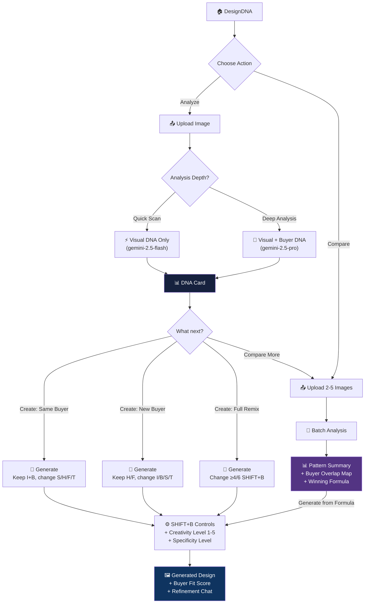

# 🧬 DesignDNA v2 — App Concept (Revised)

> **Core Shift:** Từ "phân tích thiết kế" → "phân tích thiết kế + giải mã tâm lý người mua"
> **Platform:** Google AI Studio (Build Mode → Deploy Cloud Run)

---

## 1. Revised Vision

### Before (v1)
> Upload design → AI phân tích visual elements → tạo design mới

### After (v2)
> Upload design → AI giải mã **cả visual DNA lẫn buyer DNA** → hiểu không chỉ "thiết kế trông như thế nào" mà còn "ai sẽ MUA nó và TẠI SAO" → tạo design mới target đúng người mua

```
┌──────────────────────────────────────────────────────────────┐
│                                                              │
│   DesignDNA = Visual DNA + Buyer DNA                         │
│                                                              │
│   Visual DNA:  "Thiết kế này TRÔNG như thế nào?"            │
│   Buyer DNA:   "Ai sẽ MUA nó và tại sao họ cảm thấy        │
│                 đây là thiết kế DÀNH CHO MÌNH?"              │
│                                                              │
└──────────────────────────────────────────────────────────────┘
```

### Removed: F4 Trend Advisor
- ❌ Google Search grounding cho trends → quá generic, không hữu ích cho ngách đặc thù
- ✅ Thay bằng: **Buyer DNA Analysis** — hiểu sâu tâm lý người mua từ chính thiết kế

---

## 2. The Buyer DNA Framework

### Triết lý

> Mỗi design bán tốt đều chứa **tín hiệu ẩn** — những quyết định thiết kế (dù cố ý hay vô tình) khiến một nhóm người cụ thể cảm thấy: *"Cái này nói đúng tôi."*
>
> DesignDNA không chỉ phân tích MÀU SẮC và FONT — nó giải mã **ai là người sẽ dừng scroll, click mua, và tự hào mặc/dùng sản phẩm này.**

### 5 Dimensions của Buyer DNA

```
┌─────────────────────────────────────────────────────────────┐
│                     BUYER DNA                               │
├─────────────────────────────────────────────────────────────┤
│                                                             │
│  1️⃣  BUYER PERSONA                                         │
│      Ai là người mua? Demographics + Psychographics        │
│                                                             │
│  2️⃣  IDENTITY SIGNALS                                      │
│      Design này đại diện cho "bộ lạc" nào?                 │
│      Người mua muốn thể hiện điều gì về bản thân?         │
│                                                             │
│  3️⃣  EMOTIONAL TRIGGERS                                    │
│      Cảm xúc nào khiến họ quyết định mua?                 │
│      Nút bấm tâm lý nào được kích hoạt?                   │
│                                                             │
│  4️⃣  OCCASION & TIMING                                     │
│      Khi nào design này relevant nhất?                     │
│      Mùa, dịp, context sử dụng?                           │
│                                                             │
│  5️⃣  "MADE FOR ME" DECISIONS                               │
│      Quyết định thiết kế CỤ THỂ nào tạo cảm giác         │
│      "đây là dành cho mình"?                               │
│                                                             │
└─────────────────────────────────────────────────────────────┘
```

### Chi tiết từng Dimension

#### 2.1 Buyer Persona

| Aspect | Câu hỏi AI cần trả lời | Ví dụ |
|--------|------------------------|-------|
| **Age range** | Thiết kế này hấp dẫn độ tuổi nào? | 25-35 |
| **Gender lean** | Có nghiêng về giới nào không? | Unisex, lệch nam nhẹ |
| **Interests** | Họ quan tâm đến chủ đề gì? | Outdoor, camping, vintage culture |
| **Values** | Giá trị sống của họ là gì? | Tự do, gần gũi thiên nhiên, simplicity |
| **Spending behavior** | Họ mua vì gì? Giá nào chấp nhận? | Sẵn sàng trả premium cho thiết kế "đúng vibe" |
| **Where they hang out** | Online communities, platforms? | Reddit /r/CampingGear, Instagram #vanlife |

#### 2.2 Identity Signals

> **Core question:** "Khi một người mặc/dùng sản phẩm này, họ đang nói gì với thế giới về bản thân?"

| Signal Type | Mô tả | Ví dụ |
|------------|--------|-------|
| **Tribal belonging** | "Tôi thuộc nhóm này" | Gamers, dog moms, nurses, climbers |
| **Value declaration** | "Tôi tin vào điều này" | Sustainability, freedom, equality |
| **Humor/wit** | "Tôi có sense of humor thế này" | Dry humor, dad jokes, niche memes |
| **Aesthetic identity** | "Đây là style thẩm mỹ của tôi" | Cottagecore, dark academia, Y2K |
| **Professional pride** | "Tôi tự hào về nghề này" | Teachers, developers, firefighters |
| **Life stage marker** | "Tôi đang ở giai đoạn này" | New parent, retiree, college freshman |

#### 2.3 Emotional Triggers

| Trigger | Mô tả | Design cues thường thấy |
|---------|--------|------------------------|
| **Nostalgia** | "Nhớ thời đó quá" | Retro fonts, faded colors, vintage icons |
| **Pride** | "Tự hào về bản thân/nhóm" | Bold statements, emblems, badges |
| **Belonging** | "Tôi không đơn độc" | Inside jokes, community references |
| **Defiance** | "Tôi khác biệt và tôi okay với điều đó" | Edgy style, counter-culture symbols |
| **Warmth** | "Nó cute/ấm áp quá" | Soft colors, rounded shapes, animals |
| **Empowerment** | "Tôi mạnh mẽ" | Bold typography, power poses, contrast |
| **Self-deprecation** | "Tôi tự cười bản thân" | Relatable humor, memes |

#### 2.4 Occasion & Timing

| Dimension | Câu hỏi | Ví dụ |
|-----------|---------|-------|
| **Seasonal** | Mùa nào thiết kế này relevant nhất? | Summer (beach theme), Fall (cozy vibes) |
| **Event-driven** | Có gắn với dịp nào không? | Father's Day, graduation, Halloween |
| **Mood-driven** | Mood nào khiến người ta search design này? | "Tôi cần motivation", "Tôi muốn thư giãn" |
| **Gift potential** | Đây có phải quà tặng lý tưởng không? Cho ai? | "Perfect gift cho bạn bè yêu mèo" |
| **Evergreen vs Viral** | Bán quanh năm hay theo trend? | Evergreen: "Dog mom" / Viral: "Election 2026" |
| **Context of use** | Mặc/dùng ở đâu? | Casual weekend, gym, office-appropriate? |

#### 2.5 "Made For Me" Decisions

> **Đây là dimension quan trọng nhất.** AI cần chỉ ra CHÍNH XÁC quyết định thiết kế nào tạo cảm giác "made for me."

| Decision Type | Mô tả | Ví dụ cụ thể |
|--------------|--------|---------------|
| **Niche vocabulary** | Dùng từ/thuật ngữ chỉ nhóm đó hiểu | "Git commit" trên áo dev, "Just one more cast" cho dân câu cá |
| **Cultural reference** | Tham chiếu mà chỉ "người trong cuộc" nhận ra | Anime pose style, D&D dice, cờ cụ thể |
| **Aesthetic match** | Style khớp với thẩm mỹ hiện tại của target | Minimalist cho Gen Z tech, vintage cho millennials |
| **Specificity level** | Càng cụ thể → càng "made for me" | "Dog mom" < "Golden Retriever mom" < "Golden Retriever mom who works from home" |
| **Emotional accuracy** | Nói đúng điều target ĐANG CẢM THẤY | "I'd rather be fishing" = escape fantasy |
| **Visual tribe markers** | Phong cách visual đặc trưng của nhóm | Kawaii cho anime fans, tactical/rugged cho outdoor |
| **Insider humor** | Joke mà chỉ nhóm đó thấy buồn cười | "It works on my machine" — devs only |

---

## 3. Updated Feature Map

```
┌─────────────────────────────────────────────────────────────┐
│                     DesignDNA v2                            │
├─────────────────────────────────────────────────────────────┤
│                                                             │
│  ┌─── F1: DESIGN DNA ANALYSIS ─────────────────────────┐   │
│  │                                                     │   │
│  │  Visual DNA (6 layers):                             │   │
│  │  Composition → Color → Typography → Graphics        │   │
│  │  → Strategy → POD Technical                         │   │
│  │                                                     │   │
│  │  Buyer DNA (5 dimensions):                          │   │
│  │  Persona → Identity Signals → Emotional Triggers    │   │
│  │  → Occasion & Timing → "Made For Me" Decisions      │   │
│  │                                                     │   │
│  │  Output: Complete DNA Card                          │   │
│  └─────────────────────────────────────────────────────┘   │
│                                                             │
│  ┌─── F2: CREATIVE GENERATION ─────────────────────────┐   │
│  │  From DNA → Generate new designs                    │   │
│  │  5 Creativity Levels + SHIFT method                 │   │
│  │  Now includes Buyer targeting!                      │   │
│  │  "Generate for SAME buyer" vs "DIFFERENT buyer"     │   │
│  └─────────────────────────────────────────────────────┘   │
│                                                             │
│  ┌─── F3: BATCH COMPARE ───────────────────────────────┐   │
│  │  Upload 2-5 designs cùng niche                      │   │
│  │  Find visual AND buyer patterns                     │   │
│  │  Output: Winning Formula + Buyer Overlap Map        │   │
│  └─────────────────────────────────────────────────────┘   │
│                                                             │
└─────────────────────────────────────────────────────────────┘
```

---

## 4. Updated DNA Card Schema

```json
{
  "design_dna": {
    
    "visual_dna": {
      "composition": {
        "grid_type": "rule_of_thirds",
        "symmetry": "asymmetrical",
        "focal_point": "center-upper",
        "visual_flow": "top-to-bottom",
        "density": "moderate"
      },
      "color": {
        "palette": [
          {"hex": "#2D5016", "name": "Forest Green", "role": "dominant_60"},
          {"hex": "#F5E6C8", "name": "Warm Cream", "role": "secondary_30"},
          {"hex": "#8B4513", "name": "Saddle Brown", "role": "accent_10"}
        ],
        "harmony": "analogous",
        "contrast": "medium",
        "temperature": "warm_earthy"
      },
      "typography": {
        "fonts": [
          {"classification": "slab_serif", "weight": "bold", "case": "uppercase", "role": "headline"},
          {"classification": "handwritten_script", "weight": "regular", "case": "mixed", "role": "tagline"}
        ],
        "hierarchy_levels": 2,
        "suggested_google_fonts": ["Bitter + Caveat", "Roboto Slab + Dancing Script"]
      },
      "graphics": {
        "style": "hand_drawn_illustration",
        "primary_element": "mountain landscape with pine trees",
        "secondary_elements": ["compass rose", "banner ribbon"],
        "effects": ["distressed_texture"],
        "detail_level": "medium"
      },
      "pod_technical": {
        "best_print_method": "DTG",
        "suitable_products": ["t-shirt", "hoodie", "mug", "poster"],
        "recommended_garment_colors": ["forest_green", "charcoal", "cream"],
        "scalability": "good"
      }
    },

    "buyer_dna": {
      "persona": {
        "age_range": "28-42",
        "gender_lean": "slightly_male",
        "interests": ["hiking", "camping", "nature photography", "craft beer"],
        "values": ["freedom", "simplicity", "connection with nature", "authenticity"],
        "lifestyle": "Weekend warrior — works office job during week, lives for outdoor weekends",
        "spending_mindset": "Willing to pay $28-35 for a tee that 'gets them'. Not price-sensitive for identity purchases.",
        "online_communities": ["r/hiking", "r/CampingGear", "Instagram #getoutside #traillife"]
      },
      
      "identity_signals": {
        "primary": "tribal_belonging",
        "message_to_world": "I'm not a city person at heart. Nature is where I feel alive.",
        "tribe": "Outdoor enthusiasts who see nature as identity, not just hobby",
        "aesthetic_identity": "Rustic-modern — vintage illustration style but contemporary layout"
      },
      
      "emotional_triggers": {
        "primary_emotion": "nostalgia_mixed_with_longing",
        "trigger_description": "The feeling of remembering your last great hike and craving the next one. Wearing this at the office on a Monday = silent protest against the cubicle.",
        "secondary_emotions": ["pride_in_lifestyle", "belonging_to_tribe"],
        "emotional_arc": "See design → Feel recognized ('that's ME') → Purchase as identity reinforcement"
      },
      
      "occasion_timing": {
        "best_seasons": ["spring", "summer", "early_fall"],
        "events": ["National Parks Week", "Earth Day", "Father's Day gift"],
        "mood_triggers": "End of workweek — dreaming about weekend outdoors",
        "gift_potential": {
          "score": "high",
          "who_buys_for_whom": "Partner buys for outdoor-loving SO, friend buys for hiking buddy"
        },
        "evergreen_vs_viral": "evergreen",
        "wear_context": "Casual weekend, camping trips, farmers market, dog walks"
      },
      
      "made_for_me_decisions": [
        {
          "decision": "Hand-drawn illustration style (not stock vector)",
          "why_it_works": "Signals authenticity and craftsmanship — same values as the outdoor community. Mass-produced vector art would feel 'corporate' to this buyer."
        },
        {
          "decision": "Earth-tone color palette (greens, browns, cream)",
          "why_it_works": "Colors literally match the environment they love. Wearing these colors = wearing nature. Would FAIL in neon or pastels."
        },
        {
          "decision": "Slab serif + handwritten script pairing",
          "why_it_works": "Slab serif = rugged, established, trustworthy. Script = personal, organic. Together = 'authentic outdoor brand' feeling. A geometric sans-serif would feel too tech/corporate."
        },
        {
          "decision": "Mountain + compass as subject matter",
          "why_it_works": "Universal outdoor symbols BUT with specific details (pine trees = Pacific Northwest vibe). Generic enough to appeal broadly, specific enough to feel intentional."
        },
        {
          "decision": "Distressed texture overlay",
          "why_it_works": "Creates 'worn-in' feeling — like a favorite jacket. New and pristine would feel wrong for a community that values lived experience."
        }
      ]
    }
  }
}
```

---

## 5. Updated SHIFT Method (with Buyer Dimension)

### Original SHIFT: 5 Visual Dimensions
```
S — Subject      (đổi chủ đề)
H — Harmony      (đổi color palette)
I — Identity     (đổi target audience)     ← was vague
F — Form         (đổi illustration style)
T — Text         (đổi message/typography)
```

### New SHIFT+B: 6 Dimensions (Visual + Buyer)

```
S — Subject        Đổi chủ đề/đối tượng chính
H — Harmony        Đổi color palette
I — Identity       → NOW: Đổi BUYER persona (not just "audience")
F — Form           Đổi illustration style
T — Text           Đổi message/typography
B — Buyer Emotion  ★ NEW: Đổi emotional trigger / occasion
```

### Generation Modes

| Mode | Mô tả | SHIFT+B Usage |
|------|--------|---------------|
| **Same Buyer, New Design** | Tạo design mới cho CÙNG nhóm người mua | Giữ I + B, đổi S/H/F/T |
| **Same Style, New Buyer** | Giữ style visual, nhắm đến buyer KHÁC | Giữ H/F, đổi I + B + S + T |
| **Full Remix** | Đổi tất cả → design hoàn toàn mới | Đổi ≥ 4/6 dimensions |

**Ví dụ "Same Buyer, New Design":**
```
Original: Mountain hiking illustration, earth tones, for outdoor enthusiasts
SHIFT+B: 
  S → Change: "Mountain" → "Campfire scene"
  H → Keep: Earth tones ✓ (buyer yêu thích)
  I → Keep: Outdoor enthusiasts ✓
  F → Change: "Hand-drawn" → "Woodcut print"
  T → Change: "Adventure Awaits" → "Happiest by the fire"
  B → Keep: Nostalgia + longing ✓

→ Same buyer, different design, same emotional resonance
```

---

## 6. Updated Feature Details

### F1: DNA Analysis (Updated)

**2 analysis modes:**

| Mode | Input | Output | Model |
|------|-------|--------|-------|
| **Quick Scan** | Image only | Visual DNA only (fast) | `gemini-2.5-flash` |
| **Deep Analysis** | Image + optional niche context | Visual DNA + Buyer DNA (comprehensive) | `gemini-2.5-pro` |

**Deep Analysis System Instructions (Buyer DNA section):**

```
MODE 1B — BUYER DNA ANALYSIS:

After completing visual analysis, analyze the BUYER:

PERSONA: Who would stop scrolling for this design?
- Age range, gender lean, interests, values, lifestyle
- Where they spend time online
- How they think about spending on identity products

IDENTITY SIGNALS: What is the wearer SAYING about themselves?
- What tribe do they belong to?
- What message does wearing this send to the world?
- What aesthetic identity does this align with?

EMOTIONAL TRIGGERS: What FEELING drives the purchase?
- Primary emotion (nostalgia, pride, belonging, defiance, warmth, empowerment)
- The emotional arc: See → Feel → Buy
- What internal dialogue happens at time of purchase?

OCCASION & TIMING: WHEN is this design most relevant?
- Best seasons and events
- Mood states that trigger searching for this type of design
- Gift potential (who buys for whom?)
- Evergreen vs viral lifecycle
- Context of use (when/where would they wear/display this?)

"MADE FOR ME" DECISIONS: Point out SPECIFIC design choices that 
create personal resonance. For each:
- What is the decision?
- Why does it work for THIS specific buyer?
- What would BREAK if you changed it?
```

### F2: Creative Generation (Updated)

**New generation prompt structure:**

```
Generate a new design based on these specifications:

VISUAL DIRECTION:
[From Visual DNA — modified per SHIFT+B selections]

BUYER TARGETING:
Target Buyer: [From Buyer DNA — persona description]  
Emotional Trigger: [Keep/Change — which emotion to target]
"Made For Me" Requirements: 
- Must include [specific niche signals for this buyer]
- Must use [aesthetic that matches their identity]
- Must evoke [specific emotional response]
- Avoid [things that would alienate this buyer]

SPECIFICITY LEVEL: [General / Niche / Hyper-niche]
  General: "dog lover"
  Niche: "golden retriever owner" 
  Hyper-niche: "golden retriever owner who works from home"
  
CREATIVITY LEVEL: [1-5]
```

### F3: Batch Compare (Updated)

**New output includes Buyer Overlap Map:**

```json
{
  "batch_analysis": {
    "visual_patterns": { "..." },
    
    "buyer_overlap": {
      "shared_buyer_profile": {
        "persona": "Women 25-35, pet owners, work-from-home",
        "shared_identity": "Defines self through pet relationship",
        "shared_emotion": "Warmth + gentle humor about pet parenting",
        "shared_occasion": "Everyday casual wear, gifts between pet-parent friends"
      },
      "made_for_me_patterns": [
        "All top sellers use BREED-SPECIFIC references (not generic 'dog')",
        "4/5 use FIRST-PERSON voice ('I'd rather be with my dog')",
        "3/5 use cute/kawaii illustration style",
        "0/5 use realistic photo style — all illustrated"
      ],
      "buyer_insight": "This buyer wants to feel SEEN as a specific breed owner, not just a generic dog lover. The more specific the breed reference, the stronger the 'made for me' signal.",
      "specificity_ladder": {
        "generic": "I love dogs ❌ (too broad)",
        "niche": "I love golden retrievers ✅",
        "hyper_niche": "My golden retriever is my coworker ✅✅ (highest conversion)"
      }
    },

    "winning_formula": {
      "visual": "Kawaii illustration + pastel palette + handwritten font",
      "buyer": "Breed-specific + first-person voice + daily-life humor",
      "suggested_brief": "Create a kawaii-style illustration of [SPECIFIC BREED] in a work-from-home setting, with first-person humorous text about pet-parent life. Pastel palette, handwritten font."
    }
  }
}
```

---

## 7. Updated Userflow



---

## 8. Updated Screen Mockups

````carousel

### Screen: DNA Card — Visual Tab
```
┌──────────────────────────────────────────┐
│  📊 Design DNA Card                     │
│                                          │
│  [🎨 Visual DNA]  [👤 Buyer DNA]        │
│  ─────────────  active                   │
│                                          │
│  ┌─────────┐  COMPOSITION                │
│  │ [thumb] │  Grid: Rule of Thirds       │
│  │         │  Flow: Top → Bottom         │
│  └─────────┘  Density: Moderate          │
│                                          │
│  COLOR PALETTE                           │
│  [■ #2D5016] [■ #F5E6C8] [■ #8B4513]   │
│  Analogous | Warm Earthy | Medium        │
│                                          │
│  TYPOGRAPHY                              │
│  H1: Slab Serif, Bold, UPPER            │
│  H2: Handwritten Script                  │
│  Try: Bitter + Caveat                    │
│                                          │
│  GRAPHICS                                │
│  Hand-drawn | Mountains + Compass        │
│  Effects: Distressed texture             │
│                                          │
│  POD: DTG | Tee, Hoodie, Mug            │
│  Best on: Forest green, Charcoal         │
│                                          │
│  ────────────────────────────────────    │
│  [🎨 Create: Same Buyer ▼] [📋 Copy]    │
└──────────────────────────────────────────┘
```

<!-- slide -->

### Screen: DNA Card — Buyer Tab ★ NEW
```
┌──────────────────────────────────────────┐
│  📊 Design DNA Card                     │
│                                          │
│  [🎨 Visual DNA]  [👤 Buyer DNA]        │
│                    ──────────  active     │
│                                          │
│  👤 BUYER PERSONA                        │
│  Age: 28-42 | Lean: Slightly male        │
│  Interests: Hiking, camping, craft beer  │
│  Values: Freedom, nature, authenticity   │
│  Lifestyle: "Weekend warrior —           │
│  office weekdays, trails on weekends"    │
│                                          │
│  🪪 IDENTITY SIGNAL                      │
│  Tribe: Outdoor enthusiasts              │
│  Wearing this says: "I'm not a city      │
│  person at heart. Nature is where I      │
│  feel alive."                            │
│                                          │
│  💗 EMOTIONAL TRIGGER                    │
│  Primary: Nostalgia + Longing            │
│  "Remembering last great hike,           │
│  craving the next one. Wearing this      │
│  at the office = silent protest."        │
│                                          │
│  📅 OCCASION                             │
│  Seasons: Spring → Early Fall            │
│  Gift: ✅ High (partner, hiking buddy)   │
│  Lifecycle: Evergreen                    │
│  Context: Casual, camping, weekends      │
│                                          │
│  ⭐ "MADE FOR ME" DECISIONS              │
│  ┌──────────────────────────────────┐    │
│  │ 🎨 Hand-drawn (not vector)       │    │
│  │ → Signals authenticity. Vector    │    │
│  │   would feel "corporate"         │    │
│  ├──────────────────────────────────┤    │
│  │ 🌿 Earth-tone palette            │    │
│  │ → Colors = the environment they  │    │
│  │   love. Neon would FAIL.         │    │
│  ├──────────────────────────────────┤    │
│  │ 🏔️ Mountain + compass (specific) │    │
│  │ → Universal enough yet specific   │    │
│  │   (PNW pines = intentional)      │    │
│  ├──────────────────────────────────┤    │
│  │ 📜 Distressed texture             │    │
│  │ → "Worn-in" feel = lived         │    │
│  │   experience. Pristine = wrong.  │    │
│  └──────────────────────────────────┘    │
│                                          │
│  ────────────────────────────────────    │
│  [🎨 Create: Same Buyer ▼] [📋 Copy]    │
└──────────────────────────────────────────┘
```

<!-- slide -->

### Screen: Creative Generation (SHIFT+B)
```
┌──────────────────────────────────────────┐
│  ← DNA Card    🎨 Create New Design     │
│                                          │
│  Generation Mode:                        │
│  ┌──────────────────────────────────┐    │
│  │ ● Same Buyer, New Design         │    │
│  │ ○ Same Style, New Buyer           │    │
│  │ ○ Full Remix                      │    │
│  └──────────────────────────────────┘    │
│                                          │
│  Creativity: [1 ─── 2 ─── ● ─── 4 ─ 5] │
│  Level 3: Remixed                        │
│                                          │
│  SHIFT+B Dimensions:                     │
│  [S] Subject  ● Change → [campfire  ]   │
│  [H] Harmony  ○ Keep ✓ earth tones      │
│  [I] Identity ○ Keep ✓ outdoor enthus.   │
│  [F] Form     ● Change → [woodcut   ]   │
│  [T] Text     ● Change → [by the fire]  │
│  [B] Emotion  ○ Keep ✓ nostalgia         │
│                                          │
│  Specificity Level:                      │
│  ○ General  ● Niche  ○ Hyper-niche       │
│                                          │
│  Changes: 3/6 ✅ (same buyer mode)       │
│                                          │
│       [ ✨ Generate Design ]             │
└──────────────────────────────────────────┘
```

<!-- slide -->

### Screen: Generated Result
```
┌──────────────────────────────────────────┐
│  ← Back       🖼️ Your Design            │
│                                          │
│  ┌──────────────────────────────────┐    │
│  │                                  │    │
│  │       [Generated Image]          │    │
│  │                                  │    │
│  └──────────────────────────────────┘    │
│                                          │
│  📊 Buyer Fit Analysis:                  │
│  ┌──────────────────────────────────┐    │
│  │ Buyer match:      92% ✅         │    │
│  │ Emotion match:    88% ✅         │    │
│  │ Visual originality: 76% ✅       │    │
│  │ "Made for me" signals: 4/5 ✅    │    │
│  │                                  │    │
│  │ ✅ Earth tones → buyer identity  │    │
│  │ ✅ Woodcut style → authenticity  │    │
│  │ ✅ Campfire = core experience    │    │
│  │ ⚠️ Consider adding breed-dog     │    │
│  │    for "camping with dog" niche  │    │
│  └──────────────────────────────────┘    │
│                                          │
│  💬 Refine:                              │
│  ┌──────────────────────────────────┐    │
│  │ "Add a dog sleeping by the fire" │    │
│  │                           [Send] │    │
│  └──────────────────────────────────┘    │
│                                          │
│  [⬇️ Download] [🔄 Regenerate] [📊 DNA] │
└──────────────────────────────────────────┘
```
````

---

## 9. Feasibility Update (Buyer DNA)

| Buyer DNA Feature | AI Studio Feasible? | Notes |
|-------------------|--------------------|----|
| Persona inference from image | ✅ Yes | Gemini vision excels at contextual understanding |
| Identity signal analysis | ✅ Yes | Text + visual cues → strong inference |
| Emotional trigger mapping | ✅ Yes | Mood/emotion analysis is core vision capability |
| Occasion inference | ✅ Yes | Contextual reasoning from design elements |
| "Made for me" decision mapping | ✅ Yes | Requires strong reasoning — use `gemini-2.5-pro` |
| Buyer fit scoring | ⚠️ Approximate | Score is heuristic, not data-driven |
| Specificity level control | ✅ Yes | Prompt engineering can control this |

> [!NOTE]
> **Key insight:** Buyer DNA analysis relies on Gemini's **reasoning capabilities** (not search/grounding). Gemini 2.5 Pro has strong inferential reasoning about human behavior and consumer psychology — perfect for this use case. Không cần internet search.

---

## 10. Revised MVP Scope

### MVP (v1.0)

| Feature | Priority | Notes |
|---------|----------|-------|
| F1: Visual DNA (6 layers) | **P0** | Core |
| F1: Buyer DNA (5 dimensions) | **P0** | Key differentiator |
| DNA Card UI (2 tabs: Visual + Buyer) | **P0** | Build Mode |
| F2: Generation — "Same Buyer" mode | **P0** | Most practical mode first |
| F2: Creativity Levels 1-3 | **P0** | Start simple |
| Upload + Result flow | **P0** | Standard UI |

### v1.1

| Feature | Priority | Notes |
|---------|----------|-------|
| F2: "New Buyer" + "Full Remix" modes | **P1** | Extend generation |
| F2: SHIFT+B UI controls | **P1** | More creative control |
| F2: Creativity Levels 4-5 | **P1** | Extend levels |
| F2: Specificity Level selector | **P1** | General → Hyper-niche |
| Chat refinement | **P1** | Native multi-turn |

### v1.2

| Feature | Priority | Notes |
|---------|----------|-------|
| F3: Batch Compare (2-3 images) | **P2** | Buyer overlap map |
| F3: Batch Compare (up to 5) | **P2** | Full batch |
| Buyer Fit Score on generated images | **P2** | Feedback loop |
| Copy DNA as JSON | **P2** | Power user |

---

## 11. Key Differentiator (Updated)

```
┌───────────────────────────────────────────────────────────┐
│                                                           │
│  Other tools ask: "What do you want to create?"          │
│                                                           │
│  DesignDNA asks: "WHO will feel 'this is made for me'    │
│  and WHAT design decisions create that feeling?"          │
│                                                           │
│  → Then creates designs that HIT that feeling             │
│    for the same buyer or a new one.                       │
│                                                           │
└───────────────────────────────────────────────────────────┘
```
